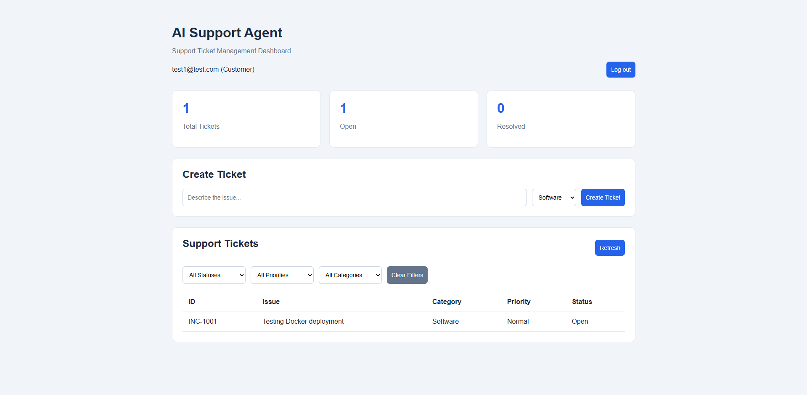
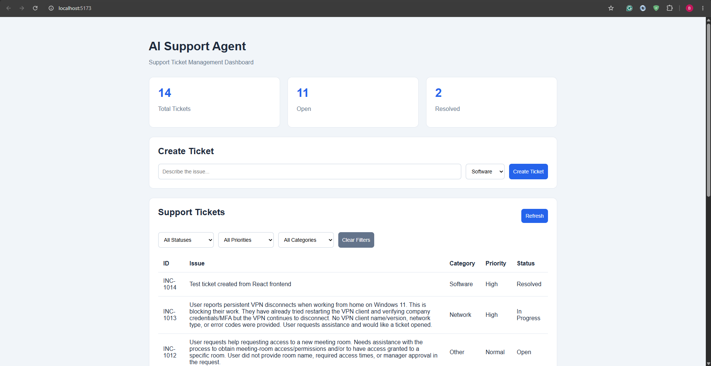
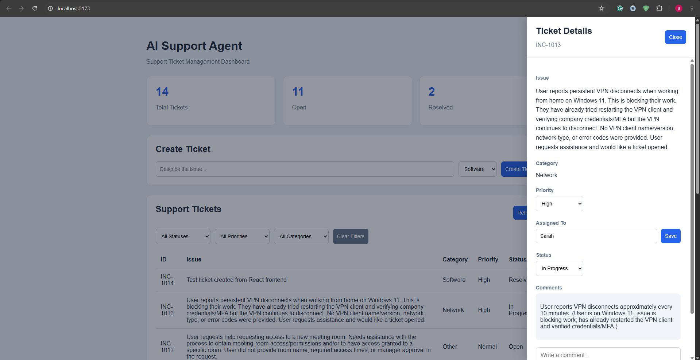

# AI Support Agent

**Full-stack IT support and ticket management with an AI-assisted workflow**

Built with **React, ASP.NET Core (.NET 10), Entity Framework Core, SQLite, and the OpenAI API**. The application combines a ticket-management dashboard with an AI assistant that can help troubleshoot IT issues and perform ticket operations after a user request.

> **Live frontend demo:** [SupportFlow Portfolio Demo](https://supportflow-demo.pages.dev)  
> **Demo source:** [SupportFlow-Demo](https://github.com/Bochum0913/SupportFlow-Demo)  
> The public demo uses **scripted AI simulations and browser-only storage**, not this project's live backend or OpenAI API.

## Features

- **AI-assisted IT troubleshooting:** conversational support, knowledge-base lookups, and continued conversations.
- **Ticket workflows:** create tickets and change ticket priority through natural-language requests to the assistant.
- **Support dashboard:** ticket counts, list and detail views, filtering by status, priority, and category.
- **Ticket administration:** status and priority updates, technician assignment, and comments.
- **Local persistence:** ticket data stored in SQLite through Entity Framework Core.
- **End-to-end testing:** Playwright test setup and ticket workflow tests.

### Example workflow

1. A user asks: *“My VPN isn't connecting. Can you help?”*
2. The assistant supplies troubleshooting guidance using a knowledge-base article.
3. The user asks the assistant to create a ticket.
4. The dashboard shows the new ticket.
5. The user asks to set the ticket's priority to High; the dashboard reflects the update.

This workflow was tested locally. The public demo reproduces comparable interactions using simulated, rules-based responses.

## Tech stack

| Layer | Technologies |
| --- | --- |
| Frontend | React, JavaScript, Vite, CSS |
| Backend | C#, ASP.NET Core Web API, .NET 10 |
| Persistence | SQLite, Entity Framework Core and migrations |
| AI integration | OpenAI API, application-side agent and knowledge-base services |
| Testing | Playwright |
| Development | Git, GitHub, Visual Studio / VS Code |

## Architecture

```text
React dashboard + AI chat
          |
          | HTTP /api requests (Vite proxy in development)
          v
ASP.NET Core Web API
  |-- Ticket controllers/services --> EF Core --> SQLite
  |-- Agent controller/service ---> Knowledge base + AI integration
  `-- Conversation handling
```

## Run locally

### Prerequisites

- .NET 10 SDK
- Node.js and npm
- An OpenAI API key with any required usage allowance, for live AI responses

### Backend

From the repository root:

```bash
dotnet restore AISupportAgent/AISupportAgent.csproj
dotnet ef database update --project AISupportAgent/AISupportAgent.csproj --startup-project AISupportAgent/AISupportAgent.csproj
dotnet run --project AISupportAgent/AISupportAgent.csproj
```

The `dotnet ef` command requires the EF Core CLI tool. Alternatively, in Visual Studio's Package Manager Console, select the `AISupportAgent` project and run `Update-Database`.

Configure the required OpenAI settings using **ASP.NET Core User Secrets or environment variables**, following the configuration keys referenced by the service code. **Never commit API keys** to GitHub. Check the backend launch URL and `frontend/vite.config.js` proxy target; the supplied configuration points to `https://localhost:7088`.

### Frontend

```bash
cd frontend
npm install
npm run dev
```

On Windows PowerShell, use `npm.cmd install` and `npm.cmd run dev` if `npm.ps1` is blocked by the execution policy.

Open the URL Vite prints (often `http://localhost:5173`). Start the backend before testing live tickets and chat.

## Public demo vs. local application

| Capability | Local full-stack project | Public portfolio demo |
| --- | --- | --- |
| AI responses | Real API-backed integration | Explicitly scripted simulation |
| Ticket persistence | SQLite database | Each browser's `localStorage` |
| Backend API | ASP.NET Core | Simulated in the browser |
| Shared multi-user tickets | Not designed as hosted production service | No |
| Public hosting | Not deployed | Cloudflare Pages |

The public demo is intended for product exploration only. Do not enter sensitive information.

## Screenshots

### Customer Dashboard

The customer dashboard provides ticket statistics, issue submission, and filtering by status, priority, and category.



If these images are available in the repository:





## Implemented Features

- User registration and login with ASP.NET Core Identity
- Role-based access control (Customer, Agent, Admin)
- Support ticket creation and management
- SQLite persistence with Entity Framework Core
- Docker Compose deployment with Nginx and HTTPS
- CSRF protection and secure authentication cookies

## Future Improvements

- Production-ready cloud deployment
- API rate limiting and monitoring
- Expanded automated integration and security tests
- Enhanced AI-powered ticket classification
- Improved dashboard analytics and reporting


## Security note

This is a portfolio project, **not a production helpdesk**. Before enabling public API access, add authentication, authorization, abuse prevention, appropriate logging, secure secret storage, and resource limits.

## Docker Deployment

AISupportAgent supports local deployment using Docker Compose. The application includes an ASP.NET Core 10 backend, a React/Vite frontend served by Nginx, and persistent SQLite storage.

### Prerequisites

- Docker Desktop or Docker Engine with Docker Compose
- Available port `8443`

### Quick Start

1. Clone the repository:

   ```bash
   git clone https://github.com/Bochum0913/AISupportAgent.git
   cd AISupportAgent
   ```

2. Optionally copy `.env.example` to `.env` and configure API credentials. External API credentials are not required for basic ticket management.

3. Build and start the application:

   ```bash
   docker compose up --build -d
   ```

4. Open the application:

   **https://localhost:8443**

   The local environment uses a self-signed HTTPS certificate, so your browser may display a certificate warning. Only proceed when testing your own localhost deployment.

5. Create a Customer account to test authentication and ticket creation.

### Stop the Application

```bash
docker compose down
```

SQLite data is stored in a persistent Docker volume and survives normal container restarts and `docker compose down`.

**Warning:** Running `docker compose down -v` removes the database volume and can permanently delete stored data.

### Optional Integrations

The application supports optional OpenAI and Microsoft Graph integrations. Configure the corresponding environment variables in a local `.env` file.

Never commit real API keys, client secrets, or passwords to the repository.

### Security Notes

- The Docker configuration is intended for local development and demonstration.
- HTTPS uses a self-signed certificate.
- The reverse proxy is configured for the included Docker network.
- Public deployment requires a trusted TLS certificate, appropriate network settings, and additional security review.